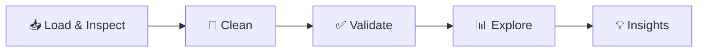

<div align="center">

# 🎬 Netflix Titles: Data Cleaning & EDA

### From messy raw CSV to clean data and clear insights, using pandas


[Overview](#-overview) •
[Dataset](#-dataset) •
[Workflow](#-workflow) •
[Insights](#-key-insights) •
[Structure](#-project-structure) •
[Learnings](#-what-i-learned)

</div>

---

## 📖 Overview

Real-world data is rarely clean. This project takes the Netflix Movies and TV Shows dataset, which has missing values, text-based dates, mixed units, and multiple values packed into single cells, and works through the full early-stage analytics process:

**Inspect → Clean → Validate → Explore → Communicate**

## 🎯 Goal

Turn a messy raw dataset into a validated, analysis-ready table, then explore it to answer practical questions about the Netflix catalogue.

### Questions explored

| # | Question |
|---|---|
| 1 | How is content split between Movies and TV Shows? |
| 2 | How has the Netflix library grown over time? |
| 3 | Which countries produce the most content? |
| 4 | Which genres dominate, and do they differ by content type? |
| 5 | What do typical movie durations and season counts look like? |
| 6 | Which audience ratings are most common? |
| 7 | How long after release does a title arrive on Netflix? |
| 8 | Which months see the most new additions? |

---

## ✨ Project Highlights

- 🧹 **Full cleaning pipeline**: missing values, duplicates, type fixes, whitespace, misplaced values
- 🧩 **Multi-valued column handling**: genres, countries, and cast unpacked for proper analysis
- 🛠 **Feature engineering**: date parts, duration split, audience groups, release-to-added gap
- ✅ **Validation checks**: before and after comparison to prove data quality
- 📊 **Visual EDA**: univariate, time-based, categorical, and bivariate analysis
- 📝 **Documented decisions**: every cleaning choice is explained, not just applied

---

## 📂 Dataset

| | |
|---|---|
| **Name** | Netflix Movies and TV Shows |
| **Source** | [Kaggle: shivamb/netflix-shows](https://www.kaggle.com/datasets/shivamb/netflix-shows) |
| **Size** | ~8,800 rows × 12 columns |
| **Format** | CSV |

> Download `netflix_titles.csv` and place it in `data/raw/`. Check the Kaggle page for licence details before redistributing the file.

### Data challenges

| Challenge | Column(s) |
|---|---|
| Large share of missing values | `director`, `cast`, `country` |
| Dates stored as text with stray whitespace | `date_added` |
| Two units in one column (minutes and seasons) | `duration` |
| Multiple values in one cell | `country`, `cast`, `listed_in` |
| A few values in the wrong column | `rating`, `duration` |
| Many categories that can be grouped | `rating` |

---

## 🔄 Workflow



### 1️⃣ Load & Inspect
**Goal:** understand the structure and quality of the raw data before touching it.
Review shape, data types, missing values, duplicates, and unique counts, and log every issue found.

### 2️⃣ Data Cleaning
**Goal:** turn the raw data into a consistent, analysis-ready table.
Standardise formatting, remove duplicates, fix misplaced values, handle missing data, correct data types, split mixed columns, engineer new features, and unpack multi-valued columns.

### 3️⃣ Validation
**Goal:** prove the cleaned data is trustworthy.
Check uniqueness, valid values, and sensible ranges, compare before and after, then save the result to `data/processed/`.

### 4️⃣ Exploratory Data Analysis
**Goal:** uncover patterns that answer the project questions.
Run univariate, time-based, categorical, and bivariate analysis with clear visualisations.

### 5️⃣ Insights & Export
**Goal:** communicate what the data says.
Summarise findings as observation, evidence, and implication, and save the best charts.

> 📄 The detailed task list for each step lives in the separate project docs (`docs/` folder).

---

## 🗂 Project Structure

```
netflix-data-cleaning-eda/
├── data/
│   ├── raw/                  # Original, untouched dataset
│   └── processed/            # Cleaned dataset
├── notebooks/
│   ├── 01_data_inspection.ipynb
│   ├── 02_data_cleaning.ipynb
│   └── 03_eda.ipynb
├── images/                   # Charts used in this README
├── requirements.txt
└── README.md
```

---

## 🧰 Tech Stack

| Tool | Purpose |
|---|---|
| **Python** | Core language |
| **pandas** | Cleaning, transformation, aggregation |
| **NumPy** | Numerical operations |
| **Matplotlib / Seaborn** | Visualisation |
| **Jupyter Notebook** | Interactive analysis and documentation |

---

## 🧠 What I Learned

- Deciding **when to fill, drop, or keep** missing values, and justifying it
- Using **string methods** to extract and standardise messy text
- Reshaping multi-valued columns so they can be counted correctly
- Validating results so cleaning does not silently break the data
- Turning charts into **clear, evidence-backed insights**

---

## 🚀 Future Improvements

- [ ] Wrap cleaning steps into reusable functions or a script
- [ ] Add interactive charts with Plotly
- [ ] Build a Streamlit dashboard
- [ ] Add a simple text-based model (Movie vs TV Show from descriptions)
- [ ] Add unit tests for the cleaning logic

---

## 🔁 Try It With Another Dataset

The same workflow works well on: **NYC Airbnb Open Data**, **Ames Housing**, **Superstore Sales**, and **Telco Customer Churn** (all on Kaggle).

---

## 📄 License

Released under the MIT License. Dataset rights belong to the original provider; see the Kaggle page for details.

---

<div align="center">

## 🙋 Author

**Your Name**
[GitHub](https://github.com/nazmul-gub) • [LinkedIn](https://linkedin.com/in/nazmul-gub) • [Email](mailto:your-nazmulhasangub001@gmail.com)

⭐ *If you found this project useful, consider giving it a star!*

</div>
